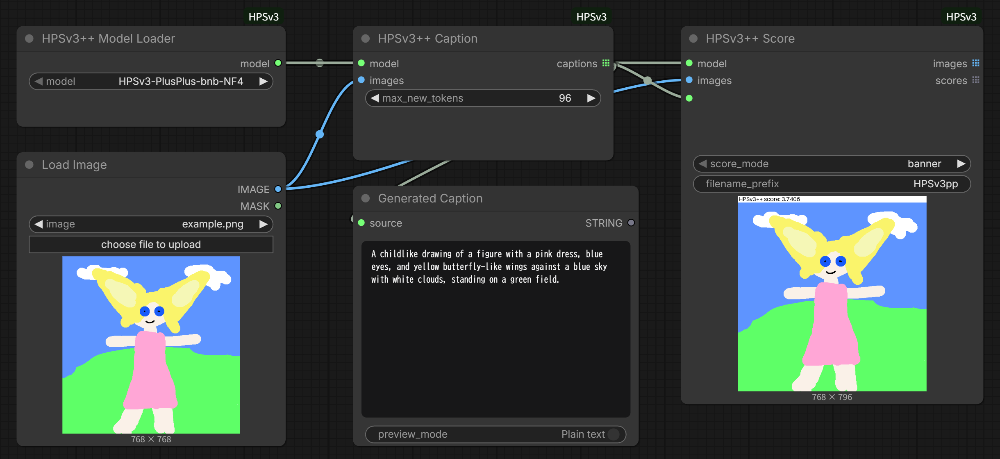
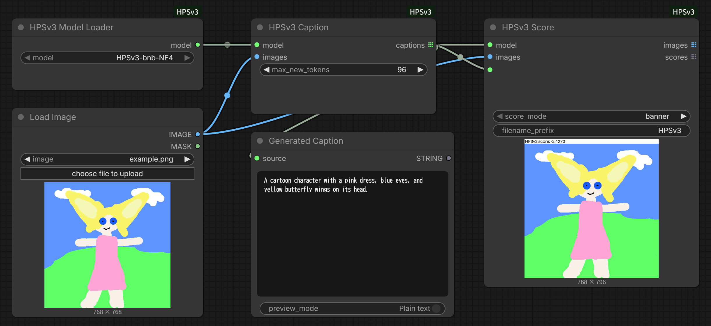

# ComfyUI-HPSv3

**English** | [日本語版はこちら](README.ja.md)

A ComfyUI extension that scores images against prompts and generates prompts from images locally, using the NF4 models of HPSv3 and HPSv3++.

| Node | Inputs | Outputs |
| --- | --- | --- |
| HPSv3++ Model Loader / HPSv3 Model Loader | Model folder | Model configuration for Score and Caption. Downloads the standard model if it is missing. |
| HPSv3++ Score / HPSv3 Score | Model, images, prompt | Saves PNGs with the score and outputs IMAGE and FLOAT lists |
| HPSv3++ Caption / HPSv3 Caption | Model, images | STRING list with one generated prompt per image |

HPSv3 and HPSv3++ models are not interchangeable. Connect a Model Loader to the Score and Caption nodes of the same series.

## Requirements

- An NVIDIA CUDA GPU with BF16 support and a driver that matches ComfyUI's PyTorch. 12 GB of VRAM is a guideline (8 GB may work, but this is untested). CPU, AMD, and Apple GPUs are not supported.
- Python 3.12 or later and Transformers 5.17.x. Dependencies are added to ComfyUI's environment; its PyTorch and torchvision are not replaced.
- Free disk space for the model: about 5.9 GB for HPSv3 and about 6.5 GB for HPSv3++.

## Installation

### ComfyUI-Manager

1. Open **Manager**, search for `ComfyUI-HPSv3`, and confirm the repository is [`Stella2211/ComfyUI-HPSv3`](https://github.com/Stella2211/ComfyUI-HPSv3).
2. Click **Install** (choose a numbered version if asked). The first installation adds dependencies and may take some time; check the ComfyUI terminal if an error appears.
3. Restart ComfyUI and reload the browser.

If the extension cannot be found, update ComfyUI and Manager, or check the [Registry page](https://registry.comfy.org/nodes/comfyui-hpsv3). If dependencies are missing in an existing installation, repair it in Manager and restart.

### Git

Run the following in `ComfyUI/custom_nodes`. The last command fetches the HPSv3++ compatibility source and is not needed when Manager installed the extension.

```sh
git clone https://github.com/Stella2211/ComfyUI-HPSv3.git
cd ComfyUI-HPSv3
uv pip install --python <ComfyUI Python> -r requirements.txt
uv run --no-project --python <ComfyUI Python> python install.py
```

## Models

Select the standard model in Model Loader and run the workflow. If it is missing, it is downloaded from Hugging Face on the first run; progress appears in the ComfyUI terminal. Score and Caption then run offline using local files only.

| Series | Model name | Source | Location |
| --- | --- | --- | --- |
| HPSv3 | `HPSv3-bnb-NF4` | [`stella221125/HPSv3-bnb-NF4`](https://huggingface.co/stella221125/HPSv3-bnb-NF4) | `ComfyUI/models/hpsv3/` |
| HPSv3++ | `HPSv3-PlusPlus-bnb-NF4` | [`stella221125/HPSv3-PlusPlus-bnb-NF4`](https://huggingface.co/stella221125/HPSv3-PlusPlus-bnb-NF4) | `ComfyUI/models/hpsv3pp/` |

- These are merged NF4 models; no base model or original checkpoint is needed.
- Only the standard model is downloaded automatically. If a download is cancelled or fails, run the workflow again to resume. The model is not used until the download is verified.
- An existing model is never updated automatically. To get a newer version, move the existing model folder elsewhere and run the workflow again.
- For offline use, download the complete model folder from Hugging Face and place it in the location above. Weights alone are not enough: `config.json`, `reward_config.json`, the tokenizer and processor files, and all safetensors files are required.
- Scores can change when the model or dependencies are updated, so use the same environment when comparing results.

## Usage

Load an example workflow, select an image in Load Image, and run it. No sample image is included.

| Example | Description |
| --- | --- |
| [caption_and_score.json](examples/caption_and_score.json) | HPSv3++: Caption generates a prompt that is passed to Score |
| [hpsv3_caption_and_score.json](examples/hpsv3_caption_and_score.json) | HPSv3: the same workflow |
| [hpsv3_score.json](examples/hpsv3_score.json) | HPSv3: Score with a prompt you enter |





The generated caption is shown in the **Generated Caption** node (Preview as Text), and the scored image is previewed and saved by Score.

### Score

Connect Model Loader to `model` and an IMAGE to `images`, and enter the evaluation prompt in `prompt`. Choose `score_mode`:

- `banner`: Adds a white bar above the image and draws the score in it. The original image is not covered.
- `metadata`: Draws nothing and stores the model name, score, and prompt as JSON in the PNG text item `hpsv3pp` (`hpsv3` for HPSv3). The IMAGE output is the input image unchanged.
- `both`: Does both.

The result is saved as a PNG in the ComfyUI output folder. `filename_prefix` supports the same date and node-value substitutions as Save Image, for example `%date:yyyy%/%date:MM%/%date:dd%/HPSv3pp`. These are applied in the browser, so they do not work when a workflow is run through the API. The score metadata belongs to the PNG saved by this node; connecting the IMAGE output to another Save Image node does not carry it over.

A single prompt is applied to all images; otherwise provide one prompt per image. Each image is scored on its own, and the IMAGE and FLOAT outputs are per-image lists in input order.

### Caption

Connect Model Loader and images. `max_new_tokens` (16 to 512, default 96) limits the length. Caption writes a short description of the image; it does not recover the original generation prompt, so review the result before using it. To score an image with its own description, connect Caption's output to Score's `prompt` and pass the same images to both nodes.

## Troubleshooting

| Symptom | Check |
| --- | --- |
| Nodes are missing after restart or a load error appears | Confirm the extension is enabled in Manager and check the ComfyUI startup log. |
| `transformers` or `bitsandbytes` cannot be found | Repair or reinstall the extension's dependencies in Manager and restart. Do not replace PyTorch or torchvision. |
| The automatic download fails | Check the internet connection, access to Hugging Face, free space, and write permission, then run the workflow again. |
| The model is reported as incomplete or invalid | Check the files listed under [Models](#models). Existing folders are not overwritten; add the missing files, or move the folder elsewhere to download it again. |
| "requires an NVIDIA CUDA GPU", or a CUDA or out-of-memory error | See the requirements above, close other applications using the GPU, and try again. |
| "Metadata is disabled" | ComfyUI was started with `--disable-metadata`. Use `banner` or remove the option. |
| "got N images but M prompts" | Provide one prompt, or one prompt per image. |

## License

The extension is MIT licensed. Model weights have their own terms; follow the license of each model repository. See [THIRD_PARTY_NOTICES.md](THIRD_PARTY_NOTICES.md) for third-party code and model notices.
